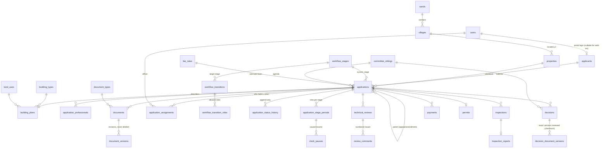

# BPTMS Phase 1: Architecture Proposal (for approval)

Status: **DRAFT, awaiting approval** · Kyengera Town Council, Town Engineer's department

## 1. Stack versions (pinned at install time)

| Component | Choice |
|---|---|
| Runtime | PHP 8.3+ (FPM), Laravel 12.x (latest stable at install) |
| DB / cache | MySQL 8.0, Redis 7 (queues, cache, sessions) |
| Staff UI | Filament (latest version compatible with the Laravel release), panel at `/staff` |
| Applicant + public UI | Livewire 3 + Tailwind CSS 4, Blade layouts |
| Auth | Fortify (login, password reset, TOTP 2FA), Argon2id hashing |
| Packages | spatie/laravel-permission, spatie/laravel-activitylog, spatie/laravel-backup, barryvdh/laravel-dompdf (permit/report PDFs), maatwebsite/excel (reports + legacy import), endroid/qr-code or simplesoftwareio/simple-qrcode |
| Quality | Pest, Pint, Larastan (level 6 to start), composer audit, Trivy image scan in CI |
| Dev/deploy | Docker Compose: `app` (php-fpm), `nginx`, `mysql`, `redis`, `queue`, `scheduler`, `clamav`, `mailpit` (dev only) |

I'm skipping spatie/medialibrary. Plain `document_versions` rows plus a private disk are simpler and give exact control over checksums and immutability.

## 2. Folder structure

```
app/
  Enums/                    ApplicationStatus, Priority, DocumentStatus, ScanStatus,
                            DecisionOutcome, ActorType, DeadlineDayType
  Models/                   Eloquent models (one per table below)
  Models/Concerns/          AppendOnly (throws on update/delete), HasOptimisticLock
  Services/
    Workflow/               WorkflowService (the ONLY status changer),
                            TransitionGuard (role + SoD + comment rules),
                            Exceptions/*
    Deadlines/              WorkingDayCalendar, DeadlineCalculator, ClockService (pause/resume)
    Applications/           ReferenceNumberGenerator, DuplicateChecker, ApplicationRegistrar,
                            TrackingPinService, FeeEstimator
    Documents/              DocumentStorage, Scanning/{VirusScanner (interface),
                            ClamAvScanner, NullScanner}
    Permits/                PermitGenerator, PermitVerifier
    Committee/              SittingScheduler
    Reports/                one query class per report
    Import/                 LegacyImporter (dry-run + commit)
  Notifications/            TransitionNotification, OverdueAlert, EscalationAlert, ...
  Notifications/Channels/   SmsChannel + Sms/{SmsGateway (interface), AfricasTalkingGateway (stub), LogGateway}
  Jobs/                     ScanDocumentVersion, GeneratePermitPdf, ...
  Console/Commands/         FlagOverdueApplications, CloseUnresponsiveApplications,
                            SendPermitExpiryReminders, AttachToCommitteeSitting
  Policies/                 one per model + DocumentVersionPolicy for downloads
  Http/Controllers/         DocumentDownloadController, PermitDownloadController,
                            PermitVerificationController
  Http/Middleware/          SecurityHeaders, EnforceTwoFactor, SessionTimeout
  Livewire/Portal/          Dashboard, ApplicationWizard (6 steps, autosave), ApplicationShow,
                            Resubmit, Payments
  Livewire/Public/          StatusCheck
  Filament/Staff/
    Resources/              Applications (with Timeline, Documents, Reviews, Inspections,
                            Decisions, Payments relation managers), Users, Roles,
                            WorkflowStages, WorkflowTransitions, PublicHolidays, FeeRates,
                            CommitteeSittings, Wards, Villages, BuildingTypes, LandUses,
                            DocumentTypes
    Pages/                  TownEngineerDashboard, MyQueue, Reports/*, LegacyImport, Settings
    Widgets/                StatsOverview, NeedsAttention, OfficerWorkload
  Support/                  Settings (typed accessor over `settings` table, cached)
config/bptms.php            upload limits, retention, scanner driver, deadline_day_type default,
                            escalation grace, inactivity days, feature flags
database/{migrations,factories,seeders}/
resources/views/{portal,public,pdf,emails}/
tests/{Unit,Feature}/       Workflow/, Deadlines/, Policies/, Public/, Documents/, Import/
docker/                     php/Dockerfile, nginx/default.conf, supervisor/*.conf, mysql/grants.sql
docs/                       ARCHITECTURE.md, DEPLOYMENT.md, BACKUP_RESTORE.md, SECURITY.md
                            (incl. breach response), guides/<role>.md
PHASE2.md
.github/workflows/ci.yml
```

## 3. ERD



Plus: `audit_logs` (spatie activitylog with its table renamed; adds `ip_address`, `user_agent`, `prev_hash`, `row_hash`), `notifications` (Laravel), `public_holidays`, `settings`, `application_sequences`, `import_batches`, and the spatie role/permission tables.

### Key table notes

- **applications**: `application_number` (unique), `bims_reference`, `applicant_id`, `property_id`, `parent_application_id`, `application_date`, `current_stage_id`, `current_status` (enum string), `assigned_officer_id`, `priority`, `stage_deadline`, `committee_sitting_id`, `fee_estimate`, `public_tracking_pin_hash`, `is_legacy`, `lock_version`, `submitted_at`, timestamps, soft deletes (drafts only). Index on `(current_status, stage_deadline, assigned_officer_id)`.
- **application_sequences** (`year` PK, `last_number`): incremented inside a transaction with `SELECT ... FOR UPDATE`. This produces `KTC/BP/2026/00125`.
- **workflow_transitions**: `from_status`, `to_status`, `to_stage_id` (nullable means stay in the current stage), `actor_type` (user/system), `requires_comment`, `notifies_applicant`, `notification_template`, `is_active`. Roles go in a pivot so one rule can allow several roles. "Any open status → withdrawn" is seeded as one explicit row per open status, which keeps the engine dumb and the table honest.
- **application_status_history**: `previous_status`, `new_status`, `stage_id`, `changed_by` (null means system), `comment`, `ip_address`, `is_legacy`, `changed_at`. Uses the AppendOnly trait, plus DB grants with no UPDATE/DELETE.
- **application_stage_periods / clock_pauses**: one row per visit to a stage (started/ended), with pause rows inside it. Elapsed council time and the legal-limit report are computed from these, never from `updated_at`.
- **document_versions**: `version_no`, `disk_path` (UUID filename on the private disk), `original_name`, `mime`, `size`, `sha256`, `scan_status` (pending/clean/infected), `uploaded_by`, `uploaded_at`, `change_note`. A version is hidden until `scan_status = clean`. No deletes.
- **review_comments**: `number` (per application), `technical_review_id`, `document_version_id` (nullable), `body`, `resolved`, `resolved_by`, `resolved_at`. Applicants have no write policy.
- **decisions**: `outcome`, `conditions`, `minute_reference`, `decided_by`, `committee_sitting_id`. The SoD check blocks the decision if `decided_by` performed any technical review on that application.
- **permits**: `permit_number`, `issued_at`, `expires_at`, `signatory_name/title`, `verification_token` (random, used in the QR URL), `pdf_path`.
- **properties**: `land_title_details` uses an encrypted cast. **applicants**: `nin` is encrypted, with a separate `nin_hash` (HMAC) so duplicates can still be found.

## 4. Workflow engine flow

```
WorkflowService::transition($app, $to, $user|null, $comment)
  1. find active transition (from = app.current_status, to)        → else InvalidTransition
  2. actor check: system-only rows need $user = null; else user has an allowed role
  3. requires_comment → non-empty comment                          → else CommentRequired
  4. TransitionGuard: SoD, optimistic lock (lock_version)
  5. DB::transaction:
       history row → close/open stage period → pause/resume clock (pauses_clock)
       → update app (status, stage, deadline via DeadlineCalculator) → audit row
  6. DB::afterCommit → queued notifications (template from transition row)
```

## 5. [CONFIRM] defaults I will use unless told otherwise

Each of these is an admin-editable setting or table row, flagged `[CONFIRM]` in the seeders and settings screen.

| Item | Default |
|---|---|
| Approval chain | As in your transition table |
| 30-day limit | `deadline_day_type = working`; stage limits 2/1/7/5/10/3 |
| Committee frequency | Monthly sittings, entered manually; agenda cut-off 5 working days before. Delegated approval flag **off** |
| Fees | Flat rate per m² by building type (placeholder figures); payment **after approval**; methods: bank, mobile money, cash receipt |
| BIMS | Optional reference field only |
| Permit signatory | Town Engineer name/title from settings; printed name + QR, no e-signature image |
| Permit validity | 3 years, reminder 60 days before expiry |
| Inactivity close | 60 days, warnings at 30 and 50 |
| Overdue escalation | Officer alerted at overdue; Town Engineer after 2 working days grace |
| Retention | 10 years after closure (configurable) |
